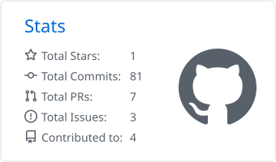
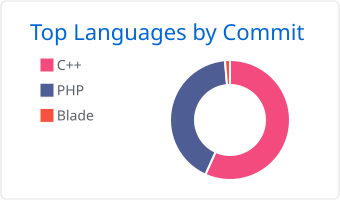

<i>"We have hope, but the world has reality."</i>

---

### About me

Hi, I'm Miftahush Syaadah, but most people call me Mita or Sya.

I'm really into databases, UI/UX design, and building web interfaces. I do it with the help of AI, of course, but I'm the one steering the ship, kind of like the guide who points the way. AI helps with execution, while the direction and vision stay mine.

I'm currently a student at Banjarmasin State Polytechnic.

Fun fact: I'm actually super clumsy, but I still hope to create things that turn out neat and pretty.

### 🧩 Evidence Board

| Category | Skills |
|:--|:--|
|**Database** | MySQL • SQL • Database Design |
|**UI/UX** | UI/UX Design • Web Interfaces • Figma • Canva |
|**Languages** | PHP • JavaScript • Dart • C++ • SQL  |
|**Tech Stack** | Laravel • Flutter • HTML • CSS |
|**Tools** | Git • GitHub • VS Code |
|**Workflow** | AI-assisted development |

### 📊 GitHub stats

  <picture>
    <source media="(prefers-color-scheme: dark)" srcset="./profile-summary-card-output/github_dark/3-stats.svg" />
    
  </picture>
  <picture>
    <source media="(prefers-color-scheme: dark)" srcset="./profile-summary-card-output/github_dark/2-most-commit-language.svg" />
    
  </picture>

  <picture>
    <source media="(prefers-color-scheme: dark)" srcset="https://streak-stats.demolab.com?user=Loxy49&theme=dark&hide_border=true&background=00000000&ring=9A86C9&fire=9A86C9&currStreakLabel=9A86C9" />
    
  </picture>

### 🐍 Contribution snake

<picture>
  <source media="(prefers-color-scheme: dark)" srcset="https://raw.githubusercontent.com/Loxy49/Loxy49/output/github-snake-dark.svg" />
  
</picture>

### Connect with me

  
  
  <!-- Uncomment and fill in to add more links:
  
  
  -->

---

  

