<i>"We have hope, but the world has reality."</i>

---

### 🌙 About me

- 🎓 D3 Informatics Engineering student
- 📍 Banjarmasin, Indonesia
- 🧠 INFJ-T: I like to think things through and build them carefully
- 🌱 Currently doing my OJT internship and exploring web development
- 📚 Learning: data structures, Laravel, and Flutter
- 🐾 Fun fact: I code best with a cat nearby

### 🛠️ Tech stack

  <picture>
    <source media="(prefers-color-scheme: dark)" srcset="https://skillicons.dev/icons?i=cpp,php,laravel,dart,flutter,html,css,js,mysql,git,github,vscode&theme=dark" />
    
  </picture>

### 📊 GitHub stats

  <picture>
    <source media="(prefers-color-scheme: dark)" srcset="./profile-summary-card-output/github_dark/3-stats.svg" />
    
  </picture>
  <picture>
    <source media="(prefers-color-scheme: dark)" srcset="./profile-summary-card-output/github_dark/2-most-commit-language.svg" />
    
  </picture>

  <picture>
    <source media="(prefers-color-scheme: dark)" srcset="https://streak-stats.demolab.com?user=Loxy49&theme=dark&hide_border=true&background=00000000&ring=9A86C9&fire=9A86C9&currStreakLabel=9A86C9" />
    
  </picture>

### 📌 Featured projects

| Project | Description | Stack |
| --- | --- | --- |
| [project-uas-ppb-fullstuck](https://github.com/Loxy49/project-uas-ppb-fullstuck) | Final project for mobile programming (UAS PPB) | Laravel · Flutter |
| [Iventaris-Bakery](https://github.com/Loxy49/Iventaris-Bakery) | Bakery inventory program | C++ |
| [Queue-LinkedList](https://github.com/Loxy49/Queue-LinkedList) | Queue and linked list practice | C++ |
| [struct-stack](https://github.com/Loxy49/struct-stack) | Struct and stack practice | C++ |

### 🐍 Contribution snake

<picture>
  <source media="(prefers-color-scheme: dark)" srcset="https://raw.githubusercontent.com/Loxy49/Loxy49/output/github-snake-dark.svg" />
  
</picture>

### 🤝 Connect with me

  
  
  <!-- Uncomment and fill in to add more links:
  
  
  -->

---

  

